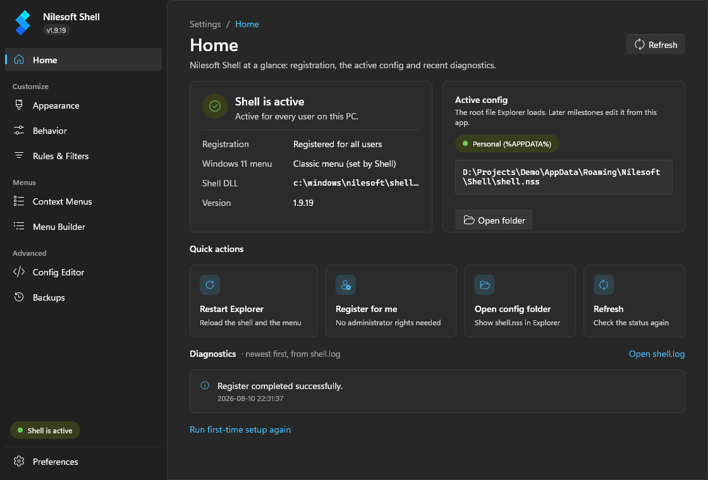
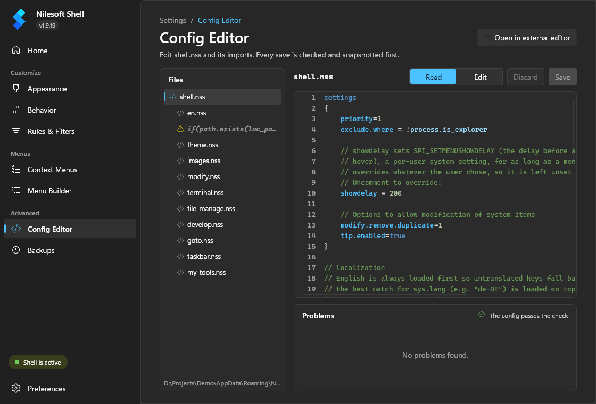
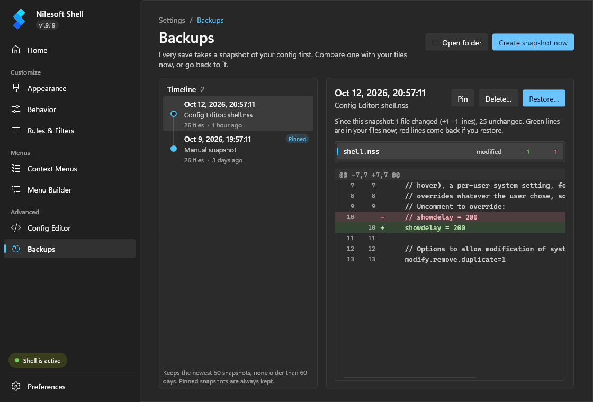
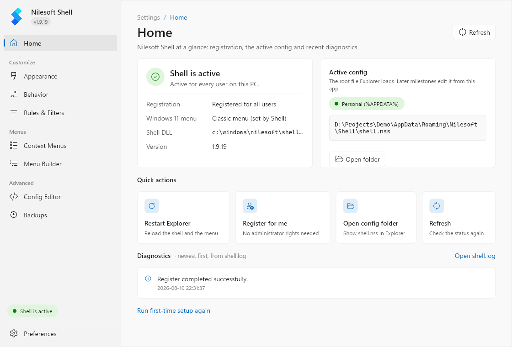

<p align="center">
  
</p>

# Nilesoft Shell Pro

A context menu manager for Windows File Explorer: add, change or remove menu items with a plain-text configuration.

[](https://github.com/Abdullah-Masood-05/Shell/actions/workflows/docs.yml)
[](LICENSE)

Nilesoft Shell Pro is a community fork of [Nilesoft Shell](https://github.com/moudey/Shell) by Moudey and
[Nilesoft](https://nilesoft.org). It is not an official Nilesoft release. It keeps the upstream configuration language
and adds security and stability fixes, a per-user mode that needs no administrator rights, and a Settings app.

- Documentation: https://abdullah-masood-05.github.io/Shell/
- Releases: https://github.com/Abdullah-Masood-05/Shell/releases
- Issues: https://github.com/Abdullah-Masood-05/Shell/issues

Pro builds are not published yet; there are no releases. To try it, [build it from source](#build-from-source).

## What's different in Pro

The full list, with credits, is on [About this fork](https://abdullah-masood-05.github.io/Shell/fork.html).

- **Security.** Registration no longer gives the Users group full control of the Windows 11 context-menu CLSID key
  (the TreatAs ACL), and no longer widens the access rights on the program folder.
  [`scripts/repair-treatas-acl.ps1`](scripts/repair-treatas-acl.ps1) repairs machines where an earlier build already
  did; run it elevated, or with `-WhatIfOnly` to only report. Windows DLLs are no longer loaded through the DLL search
  path, and `shell.dll` and `shell.exe` are built with Control Flow Guard.
- **Stability.** COM is no longer initialised from `DllMain`, a configuration that imports itself can no longer crash
  Explorer, and fixes for COM reference counting, registry reads, Win32 path buffers, UTF-8 conversion and file
  copying. `shell.exe` exits with 0 on success and non-zero on failure.
- **Menu fixes.** Duplicate removal no longer overwrites the first item, leading separators are removed, *Send to* and
  *New* are read again when opened, and menus are placed correctly on monitors with negative coordinates. Shell no
  longer changes your submenu delay, selection-fade setting or Explorer's working directory.
- **Per-user mode.** `shell -register -user` registers for the current user under `HKEY_CURRENT_USER` without
  administrator rights, and the configuration can live in `%APPDATA%\Nilesoft\Shell`.
- **Auto-reload.** The configuration reloads when `shell.nss` or any file it imports changes. A configuration with an
  error is tried again once it has been saved again. No Explorer restart is needed after editing.
- **Languages.** All language files are installed, the language follows your Windows locale with a fallback to English,
  and Norwegian (`nb-NO`, `nn-NO`) loads `no.nss`.
- **Setup.** Upgrading with the installer no longer deletes your `shell.nss`, and unregistering always removes the
  Windows 11 redirect.
- **Default configuration.** The default `shell.nss` adds the *Develop*, *Copy*, *New file* and *System* menus from
  [Abdullah-Masood-05/nilesoft-shell-config](https://github.com/Abdullah-Masood-05/nilesoft-shell-config)
  (`imports/develop.nss`, `imports/my-tools.nss`). Items for programs that are not installed are hidden.
- **Settings app.** A desktop app for checking the installation, editing the configuration and restoring backups. See
  [Settings app](#settings-app).

## Screenshots

| | |
|---|---|
|  |  |
| Settings app: Home | Settings app: Config Editor |
|  |  |
| Settings app: Backups | Settings app: Home in the light theme |

The menu itself, from upstream:

<p>
  
  
</p>

The screenshots of the Settings app are made by
[`src/settings/tools/screenshots.ps1`](src/settings/tools/screenshots.ps1), which renders the app's own window.

## Install

There is no published Pro build yet. After [building](#build-from-source), `src\bin` holds `shell.dll`, `shell.exe`,
`shell.nss`, the `imports` folder and `setup-x64.msi`.

**For all users (needs administrator rights).** Run `src\bin\setup-x64.msi`. It installs to
`C:\Program Files\Nilesoft Shell`, registers Shell with the Windows 11 classic menu and restarts Explorer.

**For the current user only (no administrator rights).** Copy `shell.dll`, `shell.exe`, `shell.nss` and the `imports`
folder to a folder you own, then run from that folder:

```bat
shell -config:init
shell -register -user -treat -restart
```

`-config:init` copies `shell.nss` and `imports` to `%APPDATA%\Nilesoft\Shell`, where you can edit them. `-treat` turns on
the classic context menu on Windows 11; leave it out on Windows 10. To remove it again:
`shell -unregister -user -restart`.

**Settings app.** Put `settings.exe`, with the files its build places next to it, next to `shell.exe`. The installer
does not include it yet. On first start it offers the same steps as above: create the personal configuration, register
for the current user, restart Explorer.

Upstream Nilesoft Shell supports Windows 7 to 11. The Settings app has only been run on Windows 11 so far.

## Settings app

`settings.exe` runs as the current user and needs no administrator rights. It works on the per-user configuration in
`%APPDATA%\Nilesoft\Shell` and reads the installation state through `shell -status`.

| Page | What it does |
|---|---|
| Home | Registration (none, user, machine or both), the Windows 11 menu state, the DLL and version in use, which `shell.nss` is loaded, recent errors from `shell.log`, and quick actions: register for me, restart Explorer, open the config folder. |
| Config Editor | A tree of `shell.nss` and its imports, a highlighted read view and an edit view. Edits are checked with `shell -config:check` before saving; saving keeps the file's encoding and line endings and takes a snapshot first. |
| Backups | Snapshots of the configuration, compared line by line with your files. Restore, pin, delete or create one by hand. |
| Preferences | The app's theme, registration for all users (the one action that asks for administrator rights), and version and licence information. |

Appearance, Behavior, Rules & Filters, Context Menus and Menu Builder are in the sidebar but not built yet.
Details: [Settings app](https://abdullah-masood-05.github.io/Shell/settings-app.html).

The app is built with [Slint](https://slint.dev) 1.18 (C++), used under the Slint Royalty-free License 2.0. It also
uses [JSON for Modern C++](https://github.com/nlohmann/json) and
[Fluent UI System Icons](https://github.com/microsoft/fluentui-system-icons), both MIT.

## Command line

Run `shell.exe` from its folder. Options start with `-` or `/`; `shell -?` shows a summary.

| Option | What it does | Admin |
|---|---|---|
| `-register` (`-r`) | Register Shell for all users | Yes |
| `-register -user` | Register for the current user only | No |
| `-unregister` (`-u`) | Remove the registration; add `-user` for a per-user one | Without `-user` |
| `-treat` (`-t`) | With `-register`, use the classic context menu on Windows 11 | As `-register` |
| `-restart` | Restart Explorer for the current session | No |
| `-silent` (`-s`) | Show no message boxes | No |
| `-config:init` / `-config:reset` | Create, or back up and recreate, the per-user configuration | No |
| `-config:path` | Print the configuration file in use | No |
| `-config:check <file>` | Parse a configuration and its imports, print the result as JSON | No |
| `-status` | Print the installation state as JSON | No |
| `-out:<file>` | Write `-config:*` and `-status` output to a file | No |

Details and output formats: [Command line](https://abdullah-masood-05.github.io/Shell/command-line.html).

## Build from source

**Core, installer.** Needs Visual Studio 2022 or its Build Tools with the *Desktop development with C++* workload. The
installer project uses the WiX Toolset SDK 5, restored from NuGet. From the repository root in PowerShell:

```powershell
$msbuild = "${env:ProgramFiles(x86)}\Microsoft Visual Studio\2022\BuildTools\MSBuild\Current\Bin\MSBuild.exe"
& $msbuild src\Shell.sln -t:restore -p:RestorePackagesConfig=true -p:Configuration=Release -p:Platform=x64
& $msbuild src\Shell.sln -m -p:Configuration=Release -p:Platform=x64
```

With the full Visual Studio instead of Build Tools, change `BuildTools` in the path to `Community`, `Professional` or
`Enterprise`. Output goes to `src\bin`.

**Settings app.** Needs CMake 3.25 or later and the Slint C++ SDK 1.18 for Windows (MSVC), for example
`Slint-cpp-1.18.1-win64-MSVC-AMD64.exe` from the [Slint releases](https://github.com/slint-ui/slint/releases). Point
`SLINT_DIR` at the folder it was installed to:

```powershell
$env:SLINT_DIR = "C:\path\to\slint-cpp-1.18.1"
cd src\settings
cmake --preset x64-release
cmake --build --preset x64-release
```

This writes `settings.exe` and `slint_cpp.dll` to `src\bin`. To refresh the screenshots afterwards, run
`pwsh -File src\settings\tools\screenshots.ps1`.

**Docs site.** Needs [bun](https://bun.sh) 1.4 or later. The pages are the HTML fragments in `docs`; see
[docs-site/README.md](docs-site/README.md).

```sh
cd docs-site
bun install
bun run check   # build to dist/, then check every link
bun run serve   # http://127.0.0.1:4000/Shell/
```

## Credits

- **Nilesoft Shell** by [Moudey](https://github.com/moudey) and [Nilesoft](https://nilesoft.org): the program this
  fork is based on.
- Fixes ported from other forks, credited in each commit message:
  [opj161/Shell](https://github.com/opj161/Shell) (security, Control Flow Guard, path, COM, registry, encoding and DPI
  fixes, keeping `shell.nss` on upgrade),
  [TCNOco/Shell](https://github.com/TCNOco/Shell) (COM outside `DllMain`, bounded imports, duplicate removal, leaving
  Explorer's settings alone) and
  [arvaidasre/Shell](https://github.com/arvaidasre/Shell) (removing the Windows 11 redirect on unregister, theme colour
  fallback, `File::Copy`, `this.count`).
- Upstream pull requests ported here: moudey/Shell#834 by MissinLinkk05551 (menus on monitors with negative
  coordinates), #836 by loliri (leading separators), #842 by jtabox (recovering from a broken configuration) and #846
  by v4806 (*Send to* and *New* submenus).
- The default menus come from
  [Abdullah-Masood-05/nilesoft-shell-config](https://github.com/Abdullah-Masood-05/nilesoft-shell-config) (MIT).

## License

MIT, see [LICENSE](LICENSE). Copyright (c) Nilesoft; the original copyright notice is kept. Third-party components keep
their own licences.
