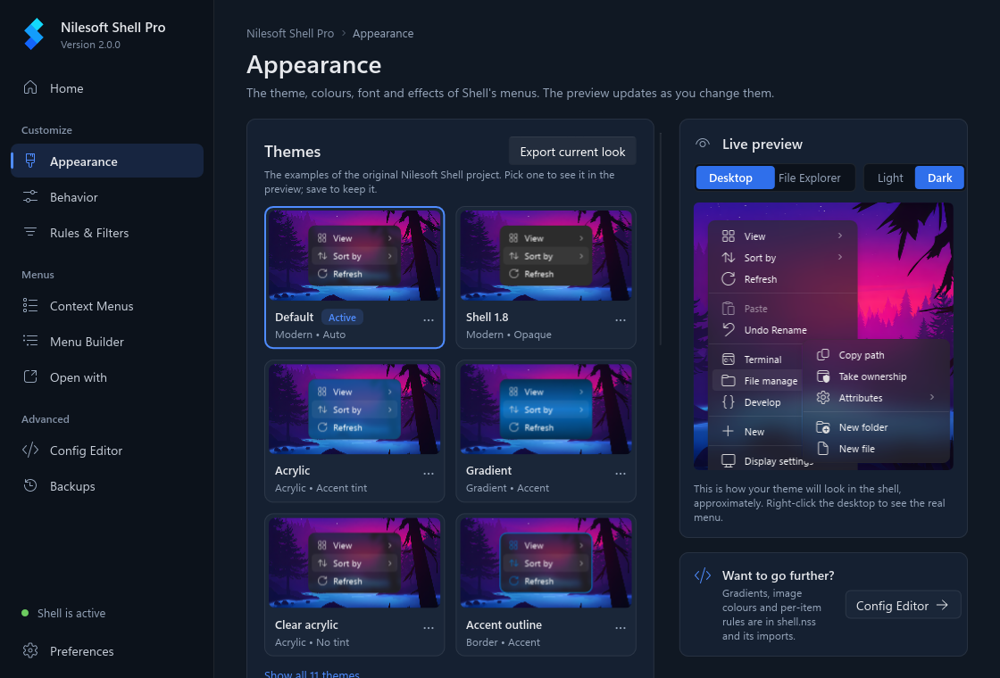
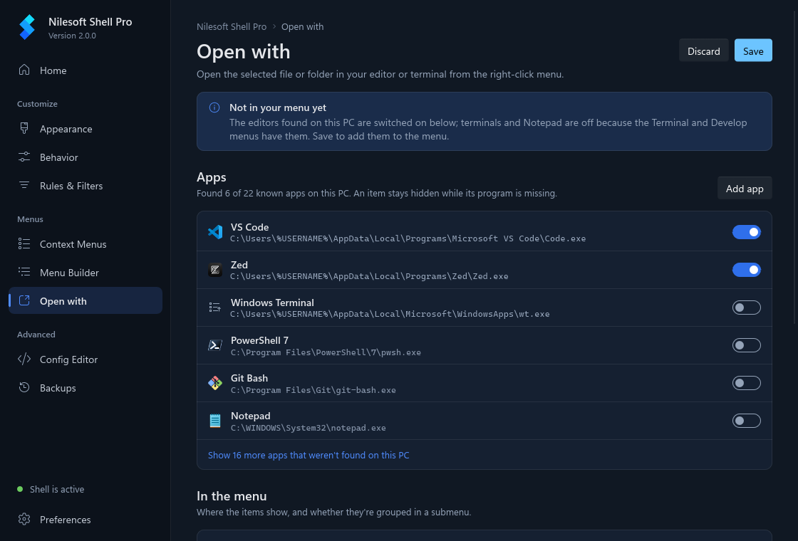
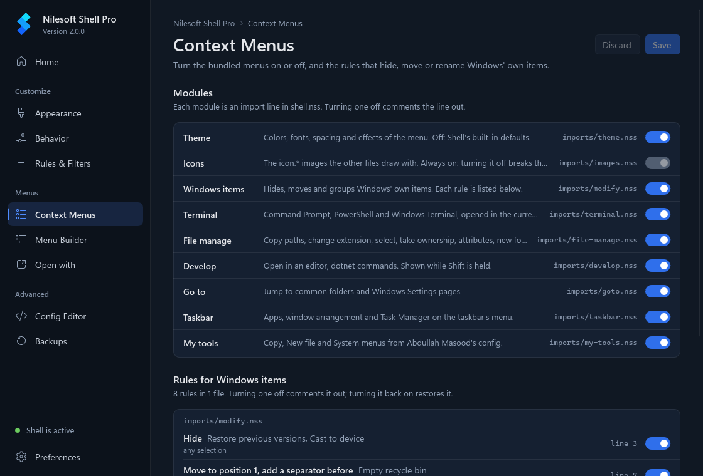
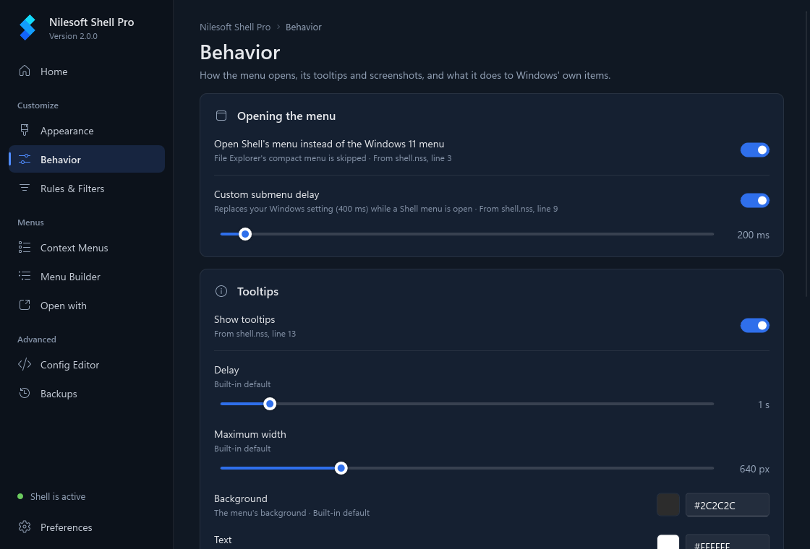
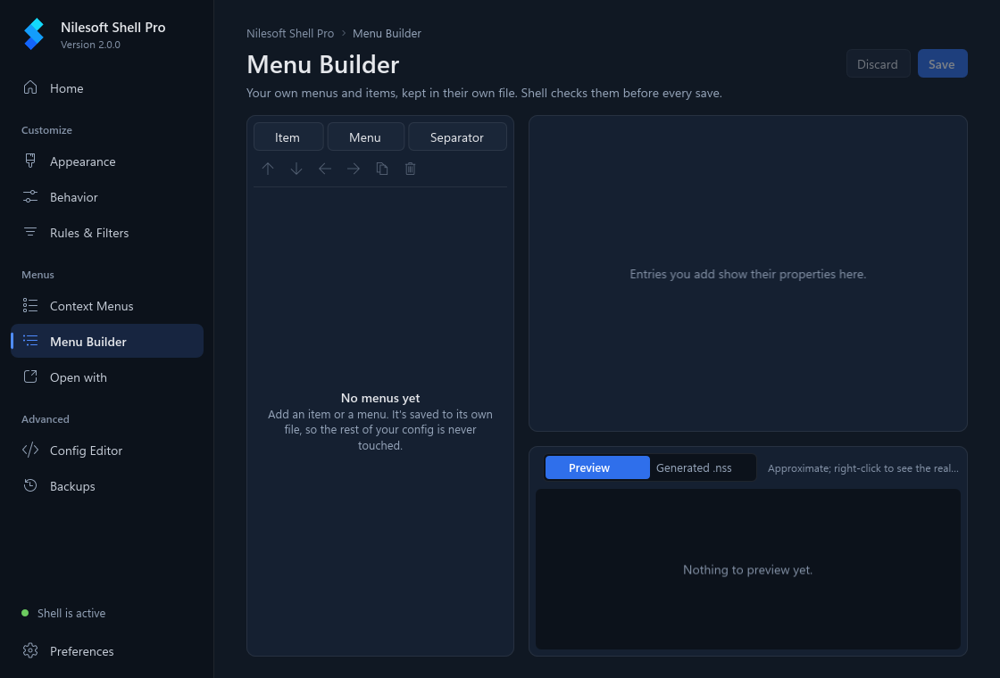

<p align="center">
  
</p>

<h1 align="center">Nilesoft Shell Pro</h1>

<p align="center">
  A context menu manager for Windows File Explorer: add, change or remove menu items with a plain-text configuration.
</p>

<p align="center">
  <a href="https://github.com/Abdullah-Masood-05/Shell/actions/workflows/build.yml"></a>
  <a href="https://github.com/Abdullah-Masood-05/Shell/actions/workflows/docs.yml"></a>
  <a href="LICENSE"></a>
</p>

<p align="center">
  <a href="https://abdullah-masood-05.github.io/Shell/"><b>Documentation</b></a> &middot;
  <a href="https://github.com/Abdullah-Masood-05/Shell/releases"><b>Download</b></a> &middot;
  <a href="https://github.com/Abdullah-Masood-05/Shell/issues">Issues</a> &middot;
  <a href="https://github.com/moudey/Shell">Original project</a> &middot;
  <a href="https://nilesoft.org">nilesoft.org</a>
</p>

<p align="center">
  A community fork of <a href="https://github.com/moudey/Shell">Nilesoft Shell</a> by Moudey and
  <a href="https://nilesoft.org">Nilesoft</a>; not an official Nilesoft release.<br>
  It keeps the upstream configuration language and adds security and stability fixes,<br>
  a per-user mode that needs no administrator rights, and an app to set it up and configure it.
</p>

**Download the latest release:**
[setup-x64.msi](https://github.com/Abdullah-Masood-05/Shell/releases/latest/download/setup-x64.msi) ·
[setup-arm64.msi](https://github.com/Abdullah-Masood-05/Shell/releases/latest/download/setup-arm64.msi) ·
[setup-x86.msi](https://github.com/Abdullah-Masood-05/Shell/releases/latest/download/setup-x86.msi) ·
[portable zip (per user, no admin)](https://github.com/Abdullah-Masood-05/Shell/releases/latest/download/NilesoftShellPro-x64-portable.zip) ·
[all releases](https://github.com/Abdullah-Masood-05/Shell/releases). These links always point to the newest release.

## What's different in Pro

The full list, with credits, is on [About this fork](https://abdullah-masood-05.github.io/Shell/fork.html).

- **Security.** Registration no longer gives the Users group full control of the Windows 11 context-menu CLSID key
  (the TreatAs ACL), and no longer widens the access rights on the program folder.
  [`scripts/repair-treatas-acl.ps1`](scripts/repair-treatas-acl.ps1) repairs machines where an earlier build already
  did; run it elevated, or with `-WhatIfOnly` to only report. Windows DLLs are no longer loaded through the DLL search
  path, and `shell.dll` and `shell.exe` are built with Control Flow Guard.
- **Stability.** COM is no longer initialised from `DllMain`, a configuration that imports itself can no longer crash
  Explorer, and fixes for COM reference counting, registry reads, Win32 path buffers, UTF-8 conversion and file
  copying. `shell.exe` exits with 0 on success and non-zero on failure.
- **Menu fixes.** Duplicate removal no longer overwrites the first item, leading separators are removed, *Send to* and
  *New* are read again when opened, and menus are placed correctly on monitors with negative coordinates. Shell no
  longer changes your selection-fade setting or Explorer's working directory, and the submenu delay is one visible
  line in `shell.nss` (`showdelay = 200`) that you can remove or turn off in the app.
- **Per-user mode.** `shell -register -user` registers for the current user under `HKEY_CURRENT_USER` without
  administrator rights, and the configuration can live in `%APPDATA%\Nilesoft\Shell`.
- **Auto-reload.** The configuration reloads when `shell.nss` or any file it imports changes. A configuration with an
  error is tried again once it has been saved again. No Explorer restart is needed after editing.
- **Languages.** All language files are installed, the language follows your Windows locale with a fallback to English,
  and Norwegian (`nb-NO`, `nn-NO`) loads `no.nss`.
- **Setup.** Upgrading with the installer no longer deletes your `shell.nss`, and unregistering always removes the
  Windows 11 redirect.
- **Default configuration.** The default `shell.nss` adds the *Develop*, *Copy*, *New file* and *System* menus from
  [Abdullah-Masood-05/nilesoft-shell-config](https://github.com/Abdullah-Masood-05/nilesoft-shell-config)
  (`imports/develop.nss`, `imports/my-tools.nss`). Items for programs that are not installed are hidden.
- **The Nilesoft Shell Pro app.** A desktop app for checking the installation, editing the configuration and restoring
  backups. See [The app](#the-app).

## Screenshots

| | |
|---|---|
|  |  |
| Appearance and the Themes gallery | Home |
|  |  |
| Open with | Context Menus |
|  |  |
| Behavior | Menu Builder |
|  |  |
| Config Editor | Backups |

The menu itself, from upstream:

<p>
  
  
</p>

The screenshots of the app are made by
[`src/settings/tools/screenshots.ps1`](src/settings/tools/screenshots.ps1), which renders the app's own window.

## Install

Each [release](https://github.com/Abdullah-Masood-05/Shell/releases) has `setup-x64.msi`, `setup-arm64.msi`,
`setup-x86.msi`, `NilesoftShellPro-<version>-x64-portable.zip` and `SHA256SUMS.txt`. The files are not code-signed, so
Windows SmartScreen may warn before running them.

**For all users (needs administrator rights once).** Run the MSI for your platform. It installs to
`C:\Program Files\Nilesoft Shell`, registers Shell with the Windows 11 classic menu, restarts Explorer and adds
*Nilesoft Shell Pro* to the Start menu. It upgrades an existing Nilesoft Shell installation and keeps your
`shell.nss`.

**For the current user only (no administrator rights).** Extract the portable zip to a folder you own, for example
`%LOCALAPPDATA%\Programs\NilesoftShellPro`, and run `NilesoftShellPro.exe`: its first-run setup does the steps below. Or run
them yourself from that folder:

```bat
shell -config:init
shell -register -user -treat -restart
```

`-config:init` copies `shell.nss` and `imports` to `%APPDATA%\Nilesoft\Shell`, where you can edit them. `-treat` turns on
the classic context menu on Windows 11; leave it out on Windows 10. To remove it again:
`shell -unregister -user -restart`.

**The app.** `NilesoftShellPro.exe` is a single file with no other dependencies (no VC++ runtime) and sits next to
`shell.exe`; double-clicking `shell.exe` opens it too. Both the MSI and the portable zip include it (x64; ARM64 runs it
under emulation; not included for x86, where the Start menu entry opens `shell.exe`).

Upstream Nilesoft Shell supports Windows 7 to 11. The app has only been run on Windows 11 so far.

## The app

Nilesoft Shell Pro (`NilesoftShellPro.exe`) runs as the current user and needs no administrator rights. It works on the per-user configuration in
`%APPDATA%\Nilesoft\Shell` and reads the installation state through `shell -status`.

| Page | What it does |
|---|---|
| Home | Registration (none, user, machine or both), the Windows 11 menu state, the DLL and version in use, which `shell.nss` is loaded, recent errors from `shell.log`, and quick actions: register for me, restart Explorer, open the config folder. |
| Config Editor | A tree of `shell.nss` and its imports, a highlighted read view and an edit view. Edits are checked with `shell -config:check` before saving; saving keeps the file's encoding and line endings and takes a snapshot first. |
| Appearance | The example themes of the original project (Default, Shell 1.8, Acrylic, Gradient, Clear acrylic, Accent outline, Flat, and the 1.x Blue, Gray, Green and Yellow) as one-click cards, then theme, dark mode, density, background colour, opacity and effect, font, corner radius, border and shadow, with a live preview of the menu on your wallpaper. Each value shows which file sets it. |
| Behavior | Whether Shell's menu replaces the Windows 11 menu, the submenu delay, tooltips, screenshots, and what happens to Windows' own items (duplicates, disabled items, separators, icons). |
| Rules & Filters | Where the menu is shown: only in File Explorer and on the desktop, excluded programs and window classes, or a raw condition. |
| Context Menus | Turn the bundled menu modules (terminal, file manage, develop, go to, taskbar, my tools) on or off, and the rules that hide, move or rename Windows' own items. |
| Menu Builder | Add your own menus, items and separators with a title, icon, command and where they appear; saved to `imports/settings-app-menus.nss`. |
| Open with | "Open with" items for editors and terminals (VS Code, Zed, Cursor, JetBrains IDEs, Windows Terminal and more), found on this PC, plus apps you add; each an "Open in <app>" item right under WinRAR or "Open in new window" (or grouped in a submenu), with a preview and a dry-run Test; other apps' own menu items (Git, VLC, 7-Zip...) can be hidden there too. Saved to `imports/settings-app-openwith.nss`. |
| Config Editor | A tree of `shell.nss` and its imports, a highlighted read view and an edit view. Edits are checked with `shell -config:check` before saving; saving keeps the file's encoding and line endings and takes a snapshot first. |
| Backups | Snapshots of the configuration, compared line by line with your files. Restore, pin, delete or create one by hand. |
| Preferences | The app's theme, updates, registration for all users (the one action that asks for administrator rights), and version and licence information. |

**Updates.** The app checks this repository's GitHub releases once a day (Preferences, *Check for updates
automatically*, on by default), downloads the MSI or portable zip that matches your install, verifies it against the
release's `SHA256SUMS.txt` and installs it after you click *Download and install* (MSI installs show one administrator
prompt). Details: [Updates](https://abdullah-masood-05.github.io/Shell/settings-app.html#updates).

Changes made on Appearance, Behavior and Rules & Filters are written to `imports/settings-app.nss`, imported last, so
your own files stay as you wrote them. Every save is checked with `shell -config:check` first, and a configuration that
Shell would reject is not written. Details: [The app](https://abdullah-masood-05.github.io/Shell/settings-app.html).

The app is built with [Slint](https://slint.dev) 1.18 (C++), used under the Slint Royalty-free License 2.0. It also
uses [JSON for Modern C++](https://github.com/nlohmann/json) and
[Fluent UI System Icons](https://github.com/microsoft/fluentui-system-icons), both MIT.

## Command line

Run `shell.exe` from its folder. Options start with `-` or `/`; `shell -?` shows a summary. Without options,
`shell.exe` opens the app (or, when `NilesoftShellPro.exe` isn't next to it, its own register and unregister window).

| Option | What it does | Admin |
|---|---|---|
| `-register` (`-r`) | Register Shell for all users | Yes |
| `-register -user` | Register for the current user only | No |
| `-unregister` (`-u`) | Remove the registration; add `-user` for a per-user one | Without `-user` |
| `-treat` (`-t`) | With `-register`, use the classic context menu on Windows 11 | As `-register` |
| `-restart` | Restart Explorer for the current session | No |
| `-silent` (`-s`) | Show no message boxes | No |
| `-config:init` / `-config:reset` | Create, or back up and recreate, the per-user configuration | No |
| `-config:path` | Print the configuration file in use | No |
| `-config:check <file>` | Parse a configuration and its imports, print the result as JSON | No |
| `-status` | Print the installation state as JSON | No |
| `-out:<file>` | Write `-config:*` and `-status` output to a file | No |

Details and output formats: [Command line](https://abdullah-masood-05.github.io/Shell/command-line.html).

## Build from source

**Core, installer.** Needs Visual Studio 2022 or its Build Tools with the *Desktop development with C++* workload. The
installer project uses the WiX Toolset SDK 5, restored from NuGet. From the repository root in PowerShell:

```powershell
$msbuild = "${env:ProgramFiles(x86)}\Microsoft Visual Studio\2022\BuildTools\MSBuild\Current\Bin\MSBuild.exe"
& $msbuild src\Shell.sln -t:restore -p:RestorePackagesConfig=true -p:Configuration=Release -p:Platform=x64
& $msbuild src\Shell.sln -m -p:Configuration=Release -p:Platform=x64
```

With the full Visual Studio instead of Build Tools, change `BuildTools` in the path to `Community`, `Professional` or
`Enterprise`. Output goes to `src\bin`.

**The app.** Needs CMake 3.25 or later, git and Rust stable for `x86_64-pc-windows-msvc` (via
[rustup](https://rustup.rs)). The release preset builds Slint 1.18.1 from source as a static library, so the first
build takes a few minutes; later builds take seconds. Set `SLINT_SOURCE_DIR` to a local Slint checkout to avoid
cloning it at configure time.

```powershell
cd src\settings
cmake --preset x64-release
cmake --build --preset x64-release
```

This writes a self-contained `NilesoftShellPro.exe` to `src\bin`. Build the core first (for `shell.exe`); then rebuild
the MSI with `-t:setup:Rebuild` to include `NilesoftShellPro.exe`. More, including a quicker dev build with the prebuilt Slint SDK:
[src/settings/README.md](src/settings/README.md). To refresh the screenshots, run
`pwsh -File src\settings\tools\screenshots.ps1`.

**Docs site.** Needs [bun](https://bun.sh) 1.4 or later. The pages are the HTML fragments in `docs`; see
[docs-site/README.md](docs-site/README.md).

```sh
cd docs-site
bun install
bun run check   # build to dist/, then check every link
bun run serve   # http://127.0.0.1:4000/Shell/
```

## Credits

- **Nilesoft Shell** by [Moudey](https://github.com/moudey) and [Nilesoft](https://nilesoft.org): the program this
  fork is based on.
- Fixes ported from other forks, credited in each commit message:
  [opj161/Shell](https://github.com/opj161/Shell) (security, Control Flow Guard, path, COM, registry, encoding and DPI
  fixes, keeping `shell.nss` on upgrade),
  [TCNOco/Shell](https://github.com/TCNOco/Shell) (COM outside `DllMain`, bounded imports, duplicate removal, leaving
  Explorer's settings alone) and
  [arvaidasre/Shell](https://github.com/arvaidasre/Shell) (removing the Windows 11 redirect on unregister, theme colour
  fallback, `File::Copy`, `this.count`).
- Upstream pull requests ported here: moudey/Shell#834 by MissinLinkk05551 (menus on monitors with negative
  coordinates), #836 by loliri (leading separators), #842 by jtabox (recovering from a broken configuration) and #846
  by v4806 (*Send to* and *New* submenus).
- The default menus come from
  [Abdullah-Masood-05/nilesoft-shell-config](https://github.com/Abdullah-Masood-05/nilesoft-shell-config) (MIT).

## License

MIT, see [LICENSE](LICENSE). Copyright (c) Nilesoft; the original copyright notice is kept. Third-party components keep
their own licences.
